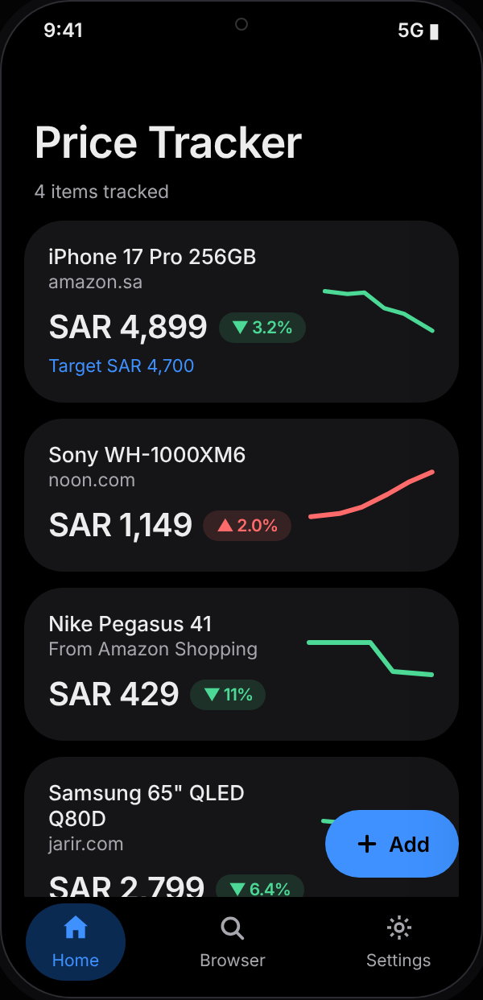
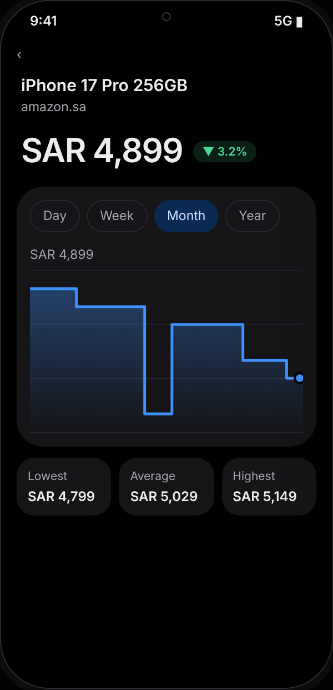
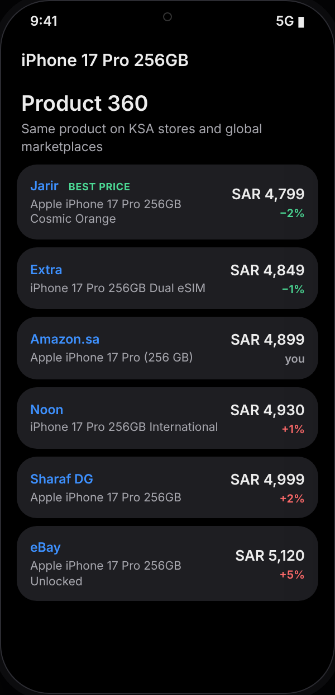
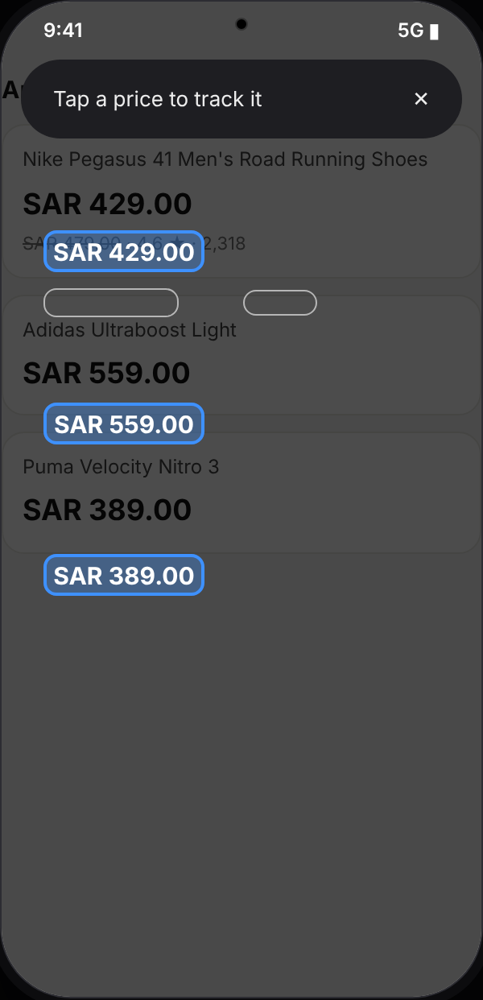
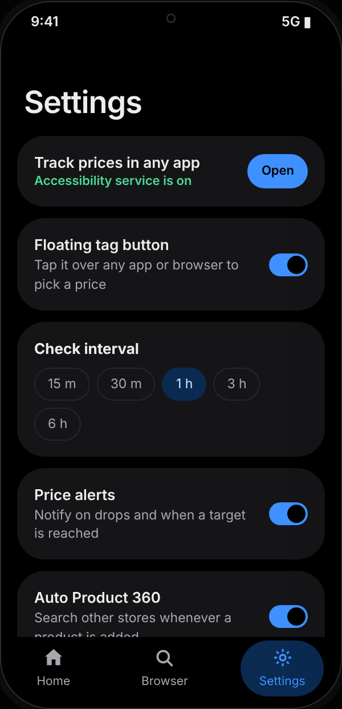

# Price Tracker

A native Android app (Kotlin, Jetpack Compose, Material 3) that tracks the price of any product, in any app or on any web page, and compares it across KSA stores and global marketplaces. Pure-black AMOLED design with One UI-style rounded surfaces. Languages: English and Arabic.

> The images below are design previews rendered from the app's layout with sample products and prices. They are not captures from a physical device.

| Home | Dashboard | History |
|---|---|---|
|  |  |  |

| Product 360 | Tap a price in any app | In-app browser |
|---|---|---|
|  |  |  |

| Settings |
|---|
|  |

## Features

- **Track in any app.** An accessibility service adds a floating tag button and a Quick Settings tile. Tap either, the screen dims and every price is outlined, tap one to track it. Prices of tracked app items are recorded again whenever they appear on screen.
- **Track on any web page.** The built-in browser highlights numbers when tap mode is on. You can also share a link from any browser, or select a price and choose **Track price** in the text menu.
- **History.** Day, Week, Month, Year and All charts with lowest, average and highest, plus drag-to-read.
- **Alerts.** Notifications on price drops and when a target price is reached. Background re-checks every 15 minutes to 24 hours.
- **Product 360.** When you add a product, the app searches Amazon.sa, Noon, Jarir, Extra, Sharaf DG, Lulu, Carrefour, Nahdi, AliExpress, eBay and Google Shopping and ranks matches by price. Results are read from each store's public search page, so a store that blocks automated requests or changes its layout will return fewer matches.
- **Dashboard.** Tracked count, savings found, drops in 24 hours, items at target, a basket price index chart, cheaper offers from other stores, and recent price moves.
- **AI (optional, Groq).** Matches the same product across stores, reads prices on pages normal parsing cannot, and gives buy-or-wait advice and a portfolio insight. Everything still works without a key, just less smartly.

## Install and update

1. Open the **Releases** page of this repository and download the newest `PriceTracker-v0.1.N.apk`.
2. Allow installs from unknown sources when Android asks, then install.
3. To track prices inside other apps: open **App info**, tap the three-dot menu, choose **Allow restricted settings**, then turn on the **Price Tracker** accessibility service.
4. In **Settings**, paste your Groq API key and tap **Test key** to enable the AI features.

**Updating keeps your data.** Install a newer APK over the old one, do not uninstall. This works because:

- every build is signed with the same key (`keystore/release.jks`), which Android requires for an update;
- the version code rises with every CI build (`GITHUB_RUN_NUMBER`), so Android treats it as an upgrade;
- the database is never wiped on upgrade. When the schema changes, bump `AppDb.version` and add a Room `Migration` in `data/Repository.kt`. Schemas are exported to `app/schemas/`.

The signing key and its password are committed for private use. If this repository becomes public, generate a new key, move its passwords to GitHub Actions secrets, and remove `keystore/release.jks` from the repo. Anyone with the key can publish an APK that installs over yours.

## Build

Android Studio, or:

```
./gradlew assembleRelease     # JDK 17, Android SDK 35
```

GitHub Actions (`.github/workflows/build-apk.yml`) builds the signed release APK on every push, attaches it to the run, and publishes it as a GitHub Release.

To compile a default AI key into your own builds, add `groq.key=YOUR_KEY` to `local.properties` (git-ignored). A key typed in Settings overrides it. CI builds have no key, so enter it in Settings on the phone.

## Project layout

```
app/src/main/java/com/pricetracker/app/
  a11y/     accessibility service, overlay, floating button, Quick Settings tile
  core/     price parser, HTML extractor, page fetcher, Product 360, Groq client, notifications
  data/     Room database and repository
  ui/       Compose screens: Home, Dashboard, Detail, Browser, Settings, quick-track sheet
  work/     WorkManager background checks
docs/screenshots/   README images
```

## Notes

- Android 17 is not a public build target yet, so the app compiles against API 35 and runs on newer versions.
- Prices read from apps depend on the app exposing its text to accessibility. Apps that draw prices into images or game-style canvases cannot be read.
